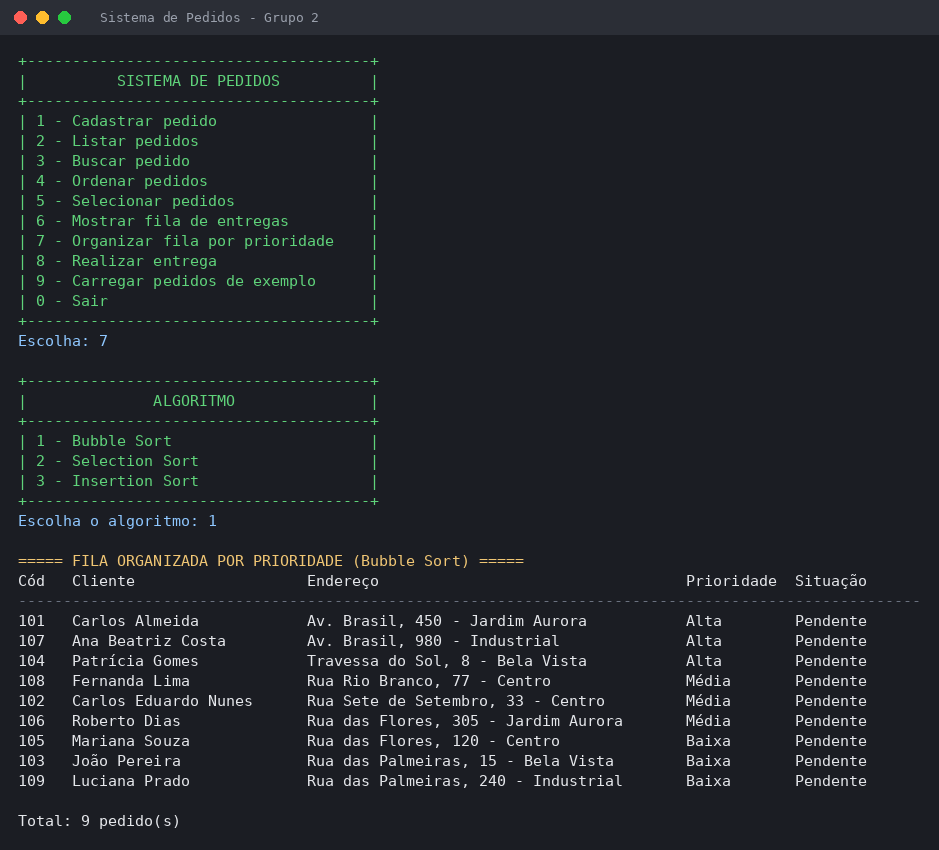
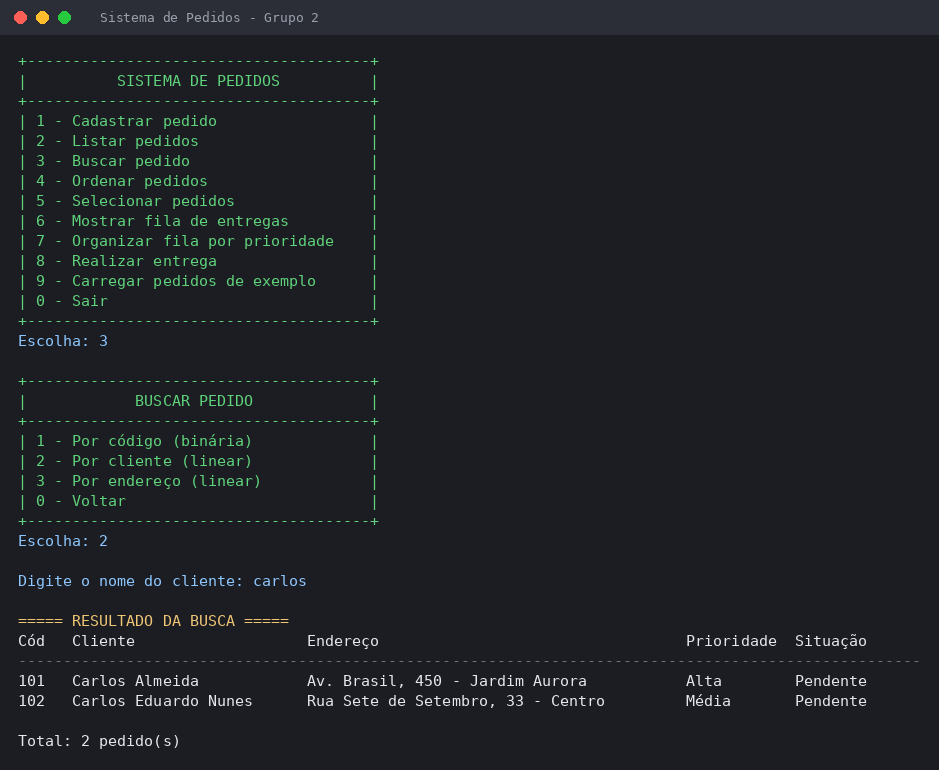
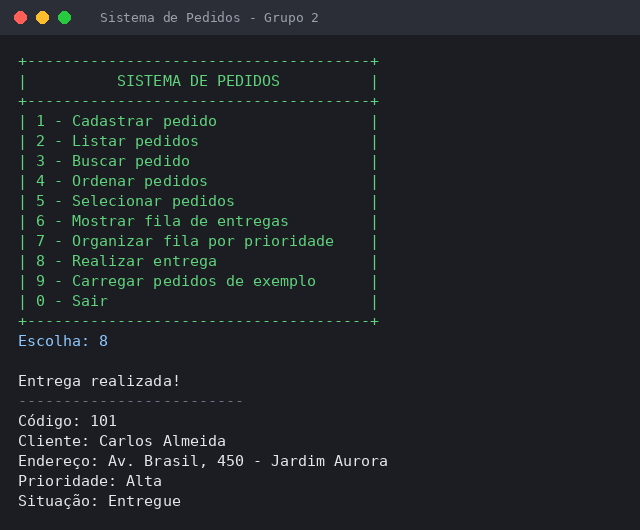

# Sistema de Entrega de Pedidos

Projeto da disciplina de Estruturas de Dados (tema 1 - Entrega de pedidos), desenvolvido em C# (.NET 8) como aplicação de console.

O sistema cadastra pedidos, mantém uma **lista de pedidos** e uma **fila de entregas**, permite **buscar** por código, cliente ou endereço, **ordenar** por prioridade (e outros critérios), **selecionar** pedidos por situação ou prioridade e registrar as entregas na ordem da fila.

## Integrantes (Grupo 2)

- Kaike
- Zaqueu
- Davi
- Leonardo
- Eduardo

## Estruturas de dados lineares

| Estrutura | Onde é usada |
|-----------|--------------|
| `List<Pedido>` | Lista de pedidos, sempre mantida ordenada por código (`ListaPedidos.cs`) |
| `Queue<Pedido>` | Fila de entregas (FIFO): cada pedido cadastrado entra no fim da fila (`FilaEntregas.cs`) |

## Algoritmos aplicados

Cada categoria possui dois ou mais parâmetros (critérios):

| Categoria | Algoritmo | Parâmetros / critérios |
|-----------|-----------|------------------------|
| Busca | Busca binária | Código do pedido (usa a lista já ordenada por código) |
| Busca | Busca linear | Cliente ou endereço (busca parcial, sem diferenciar maiúsculas) |
| Ordenação | Bubble Sort, Selection Sort e Insertion Sort | Prioridade, código, cliente ou endereço |
| Seleção | Filtro sequencial (`Selecao.Onde`) | Situação (pendentes/entregues) ou prioridade (alta/média/baixa) |

Pedidos de mesma prioridade mantêm a ordem de chegada (o desempate é a ordem de cadastro), por isso os três algoritmos de ordenação produzem exatamente o mesmo resultado. As ordenações devolvem uma nova lista e não alteram a lista de pedidos.

## Como funciona a fila de entregas

1. Ao cadastrar, o pedido entra na lista de pedidos e no fim da fila de entregas.
2. A opção **7** reorganiza a fila por prioridade (alta primeiro), com o algoritmo escolhido pelo usuário.
3. A opção **8** entrega o pedido que está na frente da fila e marca o pedido como entregue (ele continua na lista de pedidos, com situação "Entregue").

## Como executar

Requisito: [.NET SDK 8.0](https://dotnet.microsoft.com/download) ou superior.

```bash
# executar o sistema
dotnet run --project src/Entregas

# executar os testes automatizados
dotnet run --project tests/Entregas.Tests
```

Dica: ao abrir o sistema, use a opção **9** para carregar pedidos de exemplo e testar os demais recursos.

## Menu principal

```
1 - Cadastrar pedido
2 - Listar pedidos
3 - Buscar pedido (código, cliente ou endereço)
4 - Ordenar pedidos (critério + algoritmo)
5 - Selecionar pedidos (pendentes, entregues ou por prioridade)
6 - Mostrar fila de entregas
7 - Organizar fila por prioridade
8 - Realizar entrega
9 - Carregar pedidos de exemplo
0 - Sair
```

## Estrutura do projeto

```
src/Entregas/
├── Program.cs               # ponto de entrada
├── Models/                  # Pedido, Prioridade, StatusPedido
├── Algoritmos/              # Busca, Ordenacao, Selecao, CriterioOrdenacao
├── Servicos/                # ListaPedidos, FilaEntregas, ServicoEntregas, DadosExemplo
└── Interface/               # Entrada, Apresentacao, telas e menu
tests/Entregas.Tests/        # 35 testes (algoritmos, lista, fila e entregas)
docs/                        # relatório em PDF e prints da execução
```

## Testes

O projeto `tests/Entregas.Tests` é um executável de console sem dependências externas. Ele verifica as três ordenações em todos os critérios, as buscas (binária e linear), as seleções, a lista de pedidos, a fila de entregas e as regras de cadastro e entrega. Resultado atual: **35 aprovados, 0 falhas**.

## Prints da execução

Os prints completos estão em [`docs/prints`](docs/prints). Alguns exemplos:

**Fila de entregas organizada por prioridade (Bubble Sort)**



**Busca linear por cliente**



**Realização de uma entrega**



## Documentação

O relatório completo (introdução, objetivo, desenvolvimento e conclusão) está em (docs/Relatorio_Entrega_Pedidos_Grupo2.pdf).
